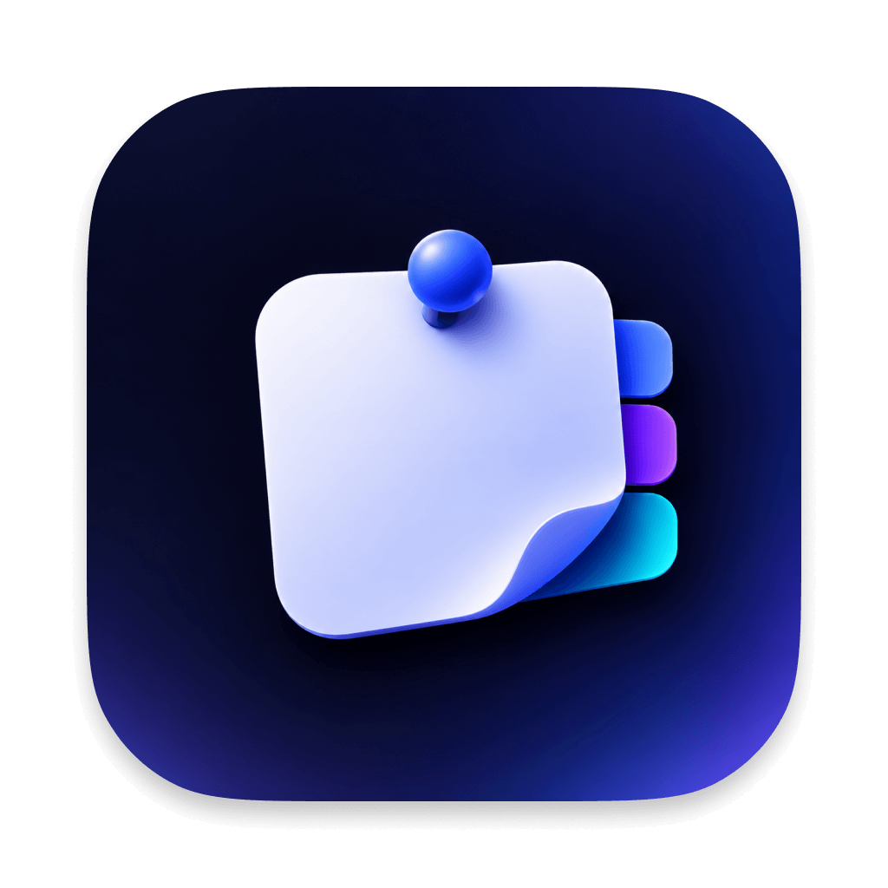
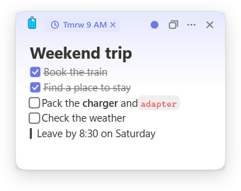
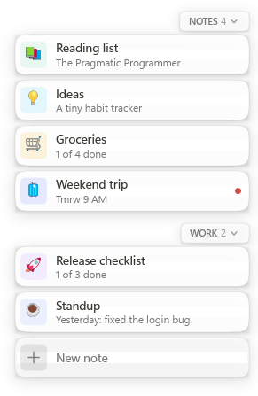
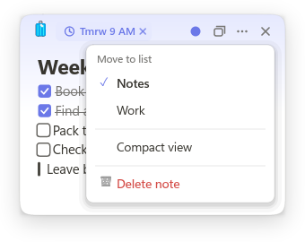
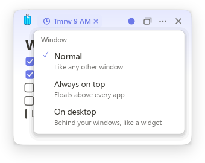
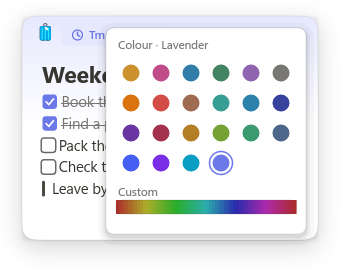
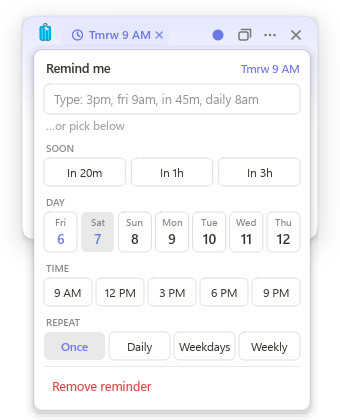
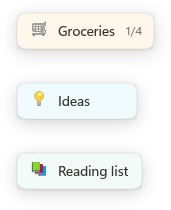
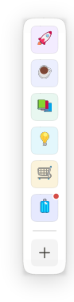
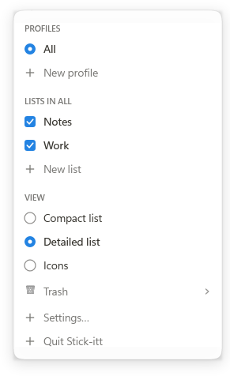

<p align="center">
  
</p>

<h1 align="center">Stick-itt</h1>

[](https://github.com/shiv122/stickitt/actions/workflows/ci.yml)
[](https://github.com/shiv122/stickitt/releases)
[](LICENSE)

Tiny, native sticky notes for macOS and Windows. Notes are native windows drawn in Rust, with
no web view, so the app starts instantly, idles at 0% CPU and uses a few megabytes of memory.

<p align="center">
  <picture>
    <source media="(prefers-color-scheme: dark)" srcset="docs/images/note-dark.png">
    
  </picture>
  &nbsp;&nbsp;
  <picture>
    <source media="(prefers-color-scheme: dark)" srcset="docs/images/dock-dark.png">
    
  </picture>
</p>

## Features

- **Markdown notes** with live preview: headings, to-dos, lists, quotes, code and links. Type
  `/` for blocks and `:fire:` for emoji.
- **Edge dock**: a slim tab on the screen edge that slides out every note, with search, lists
  and profiles.
- **Reminders**: pick a day, time and repeat, or type `@3pm`, `@fri 9am` or `@daily 8am`.
- **Window modes**: normal, always on top, or on the desktop behind your windows.
- **Compact view**: shrink a note to a single line with its icon and title.
- **Trash with undo**, hide and restore, and a tray icon to get everything back.
- **Virtual desktops** (Windows) and **Spaces** (macOS): each note stays on the desktop it was
  made on, and the dock's edge tab is on every desktop. Picking a note from another desktop in
  the dock brings it to the one you are on, and **Move to desktop** in a note's ⋯ menu sends it
  to another one, no dragging needed.
- **Configurable**: sizes, colours, the dock and every shortcut live in one commented settings
  file that applies as you save.

## Install

**macOS** (11 Big Sur or later, Apple Silicon and Intel), with [Homebrew](https://brew.sh):

```sh
brew install --cask shiv122/tap/stick-itt
```

Or download `Stick-itt-<version>-macos.dmg` from
[Releases](https://github.com/shiv122/stickitt/releases) and drag Stick-itt to Applications.

**Windows** (10 or 11, x64): from [Releases](https://github.com/shiv122/stickitt/releases),
download either

- `Stick-itt-<version>-windows-setup.exe`: installs for your user (no admin prompt), with a
  Start menu entry, an uninstaller and an option to start Stick-itt when you sign in, or
- `Stick-itt-<version>-windows-portable.exe`: runs as is, nothing to install.

Release builds are not notarized or code-signed with a paid certificate. The Homebrew cask
clears macOS's download quarantine for you. From the `.dmg`, macOS blocks the first launch: open
**System Settings → Privacy & Security** and click **Open Anyway** (or run
`xattr -dr com.apple.quarantine /Applications/Stick-itt.app`). On Windows, SmartScreen may ask
you to confirm the first launch.

## Using Stick-itt

Stick-itt opens with a welcome note. Press <kbd>Ctrl</kbd>+<kbd>Alt</kbd>+<kbd>N</kbd> anywhere
for a new one. On macOS, <kbd>Ctrl</kbd> in every shortcut here is <kbd>⌘</kbd>.

### Notes

Write in Markdown and it formats as you type: `#` headings, `- [ ]` to-dos, `-` lists, `>`
quotes, `` ` `` code and links. Type `/` at the start of a line for a menu of blocks, and
`:name:` for an emoji. Click a to-do's box (or press <kbd>Ctrl</kbd>+<kbd>Enter</kbd>) to tick it.
<kbd>Ctrl</kbd>+<kbd>=</kbd> and <kbd>Ctrl</kbd>+<kbd>-</kbd> zoom the text.

Select text and a toolbar appears over it: **B**old, *I*talic, ~~S~~trikethrough, `</>` code,
🔗 link, and a colour menu with two rows, as in Notion: the text's **colour** and its
**background** (gray, brown, orange, yellow, green, blue, purple, pink, red). Each button
toggles, so it also undoes itself. It is all plain Markdown underneath: `==green:On track==` is a
background, `{red: overdue}` a text colour, and <kbd>Ctrl</kbd>+<kbd>Shift</kbd>+<kbd>H</kbd>
highlights the selection. <kbd>Ctrl</kbd>+click (<kbd>⌘</kbd>+click) opens a link.

A quote that starts with an emoji is a callout, a soft box like Notion's: `> 💡 Ship on Friday`
(or **Callout** in the `/` menu).

Tables are drawn as a grid, Notion-style, and you edit them right in the grid:

- Type in a cell. <kbd>Tab</kbd> and <kbd>Shift</kbd>+<kbd>Tab</kbd> move between cells (Tab
  after the last one adds a row), <kbd>Enter</kbd> goes to the cell below, and the arrow keys
  move between cells and rows.
- Point at a cell for its handles: **⋮⋮** left of the row opens Insert above / below, Duplicate,
  Move up / down, Delete row and Delete table; **⋯** above the column opens Align (left, center,
  right), Insert left / right, Move left / right and Delete column.
- To leave a table, press <kbd>↓</kbd> or <kbd>Esc</kbd> in its last row, or <kbd>Enter</kbd> on an
  empty last row; clicking below a table at the end of a note starts a new line there.
- Prefer buttons? `table_buttons = true` in `[notes]` adds **+** on a table's bottom and right
  edges for a new row or column.

Write tables in the usual Markdown way, or pick **Table** from the `/` menu.

```
| Deal       | Stage    | Value |
| ---------- | -------- | ----- |
| Acme Corp  | Proposal | $48k  |
| Brightline | **Won**  | $61k  |
```

Hover a note to show its controls along the top:

| Control | What it does |
|---|---|
| Icon | Pick an emoji for the note (it shows in the dock and in compact view). |
| Reminder chip | When the reminder is due; click it to change it, × to clear it. |
| Colour dot | 22 colours plus a custom hue strip. New notes take a different colour each time. |
| Window | Normal, always on top, or on the desktop behind your windows. |
| ⋯ | Move the note to another list or another virtual desktop, switch to compact view, or delete it. |
| × | Hide the note. It stays in the dock; click it there to bring it back. |

<table>
  <tr>
    <td align="center">
      <picture>
        <source media="(prefers-color-scheme: dark)" srcset="docs/images/note-menu-dark.png">
        
      </picture>
      <br><sub>⋯ menu: list, compact view, delete</sub>
    </td>
    <td align="center">
      <picture>
        <source media="(prefers-color-scheme: dark)" srcset="docs/images/note-window-dark.png">
        
      </picture>
      <br><sub>Window mode</sub>
    </td>
    <td align="center">
      <picture>
        <source media="(prefers-color-scheme: dark)" srcset="docs/images/note-colors-dark.png">
        
      </picture>
      <br><sub>Colours</sub>
    </td>
  </tr>
</table>

Deleted notes go to the trash, and a toast offers **Undo** for a few seconds. Delete asks for a
second click so it can't happen by accident (`confirm_delete`).

### Reminders

Click the clock (or press <kbd>Ctrl</kbd>+<kbd>R</kbd>) to set one: a quick "in 20 minutes",
or a day of the coming week, a time and a repeat (once, daily, weekdays, weekly). Under the
times, **−1h −5m [time] +5m +1h** sets any time to the minute: step it, then click the time. You
can also type the time in the reminder box, or straight into the note:

```
@3pm   @in 45m   @fri 9am   @tomorrow at 2pm   @daily 8am   @weekdays 9am   @every mon 10am
```

When it is due the note jumps to the front with a short chime, and glows red until you snooze it
(**10m**, **1h**) or mark it **Done**. It wiggles when it starts, again a few seconds later, and
then every 45 seconds.

<p align="center">
  <picture>
    <source media="(prefers-color-scheme: dark)" srcset="docs/images/note-reminder-dark.png">
    
  </picture>
</p>

### Compact view

Choose **Compact view** in the ⋯ menu (or <kbd>Ctrl</kbd>+<kbd>Shift</kbd>+<kbd>M</kbd>) to
fold a note into one line: its icon, its title and, for checklists, how many to-dos are done.
Click the line to open the note, and it folds back when you click elsewhere. Drag it to move it.

<p align="center">
  <picture>
    <source media="(prefers-color-scheme: dark)" srcset="docs/images/compact-dark.png">
    
  </picture>
</p>

### The dock

Rest the pointer on the right edge of the screen (or press
<kbd>Ctrl</kbd>+<kbd>Alt</kbd>+<kbd>D</kbd>) and the dock slides out with every note, grouped by
list. Hovering a card floats that note to the front, clicking it brings the note up (even a
hidden one), and typing searches. **New note** at the bottom adds a note to the list.

- **Move it**: drag the tab up or down the edge, or drag any card to the other side of the screen.
- **Resize it**: <kbd>Ctrl</kbd>+scroll (<kbd>⌘</kbd>+scroll on macOS) over the dock.
- **Views**: a compact list, a detailed list with a line of each note, or icons that magnify
  under the pointer like the macOS Dock.

<table>
  <tr>
    <td align="center" valign="top">
      <picture>
        <source media="(prefers-color-scheme: dark)" srcset="docs/images/dock-dark.png">
        
      </picture>
      <br><sub>Detailed list</sub>
    </td>
    <td align="center" valign="top">
      <picture>
        <source media="(prefers-color-scheme: dark)" srcset="docs/images/dock-icons-dark.png">
        
      </picture>
      <br><sub>Icons</sub>
    </td>
    <td align="center" valign="top">
      <picture>
        <source media="(prefers-color-scheme: dark)" srcset="docs/images/dock-menu-dark.png">
        
      </picture>
      <br><sub>Right-click menu</sub>
    </td>
  </tr>
</table>

**Right-click the dock** for everything else:

- **Profiles**: sets of lists you switch between, such as Work and Home
  (<kbd>Ctrl</kbd>+<kbd>Alt</kbd>+<kbd>P</kbd> for the next one). Each virtual desktop (Windows)
  or Space (macOS) can remember its own profile.
- **Lists**: tick the lists the current profile shows, add new ones, or remove one with its ×.
  Move a note between lists from its ⋯ menu. Notes start in the built-in Notes list, so you only
  need more lists if you want them. Removing a list that has notes asks whether to keep them
  (they move to Notes) or put them in the Trash.
- **View**: compact list, detailed list or icons.
- **Trash**: click a note to restore it, or **Empty trash** (two clicks). Notes are deleted for
  good after 30 days (`trash_days`).
- **Settings…** opens `stickit.ini`, and **Quit Stick-itt** quits.

The tray icon (menu bar on macOS) has a new note, paste as note, the dock, hide or show every
note (<kbd>Ctrl</kbd>+<kbd>Alt</kbd>+<kbd>H</kbd>), a list of hidden notes, settings and quit. Closing the windows from the taskbar
sends Stick-itt to the tray rather than quitting.

### Shortcuts

| Anywhere | | In a note | |
|---|---|---|---|
| <kbd>Ctrl</kbd>+<kbd>Alt</kbd>+<kbd>N</kbd> | New note | <kbd>Ctrl</kbd>+<kbd>N</kbd> | New note |
| <kbd>Ctrl</kbd>+<kbd>Alt</kbd>+<kbd>V</kbd> | Clipboard to note | <kbd>Ctrl</kbd>+<kbd>R</kbd> / <kbd>Ctrl</kbd>+<kbd>Shift</kbd>+<kbd>R</kbd> | Set / clear reminder |
| <kbd>Ctrl</kbd>+<kbd>Alt</kbd>+<kbd>D</kbd> | Open the dock | <kbd>Ctrl</kbd>+<kbd>T</kbd> | Next window mode |
| <kbd>Ctrl</kbd>+<kbd>Alt</kbd>+<kbd>H</kbd> | Hide / show notes | <kbd>Ctrl</kbd>+<kbd>Shift</kbd>+<kbd>M</kbd> | Compact view |
| <kbd>Ctrl</kbd>+<kbd>Alt</kbd>+<kbd>P</kbd> | Next profile | <kbd>Ctrl</kbd>+<kbd>Shift</kbd>+<kbd>L</kbd> | Note menu |
| <kbd>Ctrl</kbd>+<kbd>Alt</kbd>+<kbd>,</kbd> | Settings | <kbd>Ctrl</kbd>+<kbd>Shift</kbd>+<kbd>K</kbd> / <kbd>C</kbd> | Pick / next colour |
| | | <kbd>Ctrl</kbd>+<kbd>Shift</kbd>+<kbd>I</kbd> | Pick an icon |
| | | <kbd>Ctrl</kbd>+<kbd>B</kbd> <kbd>I</kbd> <kbd>E</kbd>, <kbd>Ctrl</kbd>+<kbd>Shift</kbd>+<kbd>X</kbd> | Bold, italic, code, strikethrough |
| | | <kbd>Ctrl</kbd>+<kbd>Shift</kbd>+<kbd>H</kbd> | Highlight |
| | | <kbd>Ctrl</kbd>+<kbd>Enter</kbd> | Tick a to-do |
| | | <kbd>Ctrl</kbd>+<kbd>W</kbd> / <kbd>Ctrl</kbd>+<kbd>D</kbd> | Hide / delete |

Every shortcut can be changed or turned off in the settings file.

## Configuration

Everything is in `stickit.ini`, created on first launch next to your notes:

| | Location |
|---|---|
| Windows | `%APPDATA%\Stick-itt\` |
| macOS | `~/Library/Application Support/Stick-itt/` |

Open it with **Settings…** in the dock or tray menu, or
<kbd>Ctrl</kbd>+<kbd>Alt</kbd>+<kbd>,</kbd>. Every option is listed with a comment, and saved
changes apply within a second. Sizes are in pixels at 100% display scaling. A value that can't
be read keeps its default, and new options are added to the file when you update.
Notes are stored in `stickit.db` (SQLite) in the same folder.

An example: a narrower dock on the left that opens faster, larger note text, and blue new notes:

```ini
[notes]
font_size     = 16
default_color = cobalt

[dock]
side          = left
open_delay_ms = 120

[dock.list]
width         = 220
```

<details>
<summary><b>[general]</b>: the app</summary>

| Key | Default | |
|---|---|---|
| `theme` | `auto` | `auto` follows the system's light or dark mode; `light` or `dark` picks one |
| `tray_icon` | `true` | Icon in the notification area (menu bar) with a quick menu |
| `confirm_delete` | `true` | "Delete note" asks for a second click |
| `trash_days` | `30` | Days a deleted note stays in the trash |
| `undo_seconds` | `6` | How long the "Note deleted · Undo" toast stays |

</details>

<details>
<summary><b>[notes]</b>: how notes look</summary>

| Key | Default | |
|---|---|---|
| `default_color` | `cycle` | Colour of new notes: `cycle`, `random`, a name (`lavender`, `cobalt`, `yellow`…) or a hue `0`–`359` |
| `font_size` | `14.5` | |
| `line_height` | `1.5` | Multiple of the font size |
| `icon_position` | `bar` | `bar`: small, in the top strip; `page`: large, above the text |
| `icon_size` | `18` | |
| `top_bar` | `38` | Height of the top strip (icon, reminder, controls) |
| `gap` | `2` | Space between the top strip and the text |
| `padding` / `bottom_padding` | `20` / `16` | Space around the text |
| `radius` | `18` | Corner radius |
| `shadow` | `1` | `0` none, `2` strong |
| `cover` | `1` | The colour fading in from the top: `0` plain, `1` full |
| `appear_scale` | `0.97` | Size a note grows from as it appears; `1` fades only |
| `table_buttons` | `false` | **+** buttons on a table's edges to add a row or a column |

Colour names: Yellow, Pink, Blue, Green, Purple, Gray, Orange, Red, Brown, Teal, Sky, Indigo,
Violet, Rose, Amber, Lime, Mint, Slate, Cobalt, Grape, Aqua, Lavender.

</details>

<details>
<summary><b>[notes.compact]</b>: compact view</summary>

| Key | Default | |
|---|---|---|
| `height` | `36` | Height of the one-line note |
| `min_width` / `max_width` | `120` / `240` | Longer titles end in … |
| `font_size` / `icon_size` | `13.5` / `15` | |
| `padding` | `12` | Space at either end |
| `radius` | `12` | Corner radius (capped at a full pill) |
| `tint` | `0.55` | How much of the note's colour shows; `0` plain |
| `show_progress` | `true` | Show `2/5` for notes with to-dos |
| `collapse_on_blur` | `true` | An opened compact note folds back when you click elsewhere |

</details>

<details>
<summary><b>[notes.fade]</b>: fade notes you aren't using</summary>

A faded note comes back to full strength as soon as you point at it. Notes you are typing in,
notes with a menu open and ringing reminders never fade.

| Key | Default | |
|---|---|---|
| `enabled` | `false` | Turn fading on |
| `after` | `30` | Seconds without focus or the pointer before a note fades |
| `opacity` | `0.35` | How visible a faded note stays, `0.05`–`1` |
| `which` | `on_top` | `on_top`: only always-on-top notes; `all`: every note |
| `compact` | `true` | Compact (one-line) notes fade too |

</details>

<details>
<summary><b>[dock]</b>, <b>[dock.list]</b>, <b>[dock.icons]</b>, <b>[dock.tab]</b>: the dock</summary>

| Key | Default | |
|---|---|---|
| `[dock]` `side` | `right` | `left` or `right` (dragging the dock sets it too) |
| `position` | `0.5` | Along the edge: `0` top, `1` bottom (dragging the tab sets it too) |
| `open_delay_ms` | `250` | How long the pointer rests on the edge before the dock opens |
| `edge_gap` | `10` | Distance from the screen edge |
| `[dock.list]` `width` | `264` | Card width (also <kbd>Ctrl</kbd>+scroll) |
| `card_gap` / `row_padding` | `3` / `6` | Spacing between and inside cards |
| `font_size` / `icon_size` | `13.5` / `16` | |
| `radius` | `16` | Card corner radius |
| `opacity` | `0.96` | `0.5`–`1` |
| `hover_push` | `26` | How far a hovered card slides out; `0` off |
| `list_headers` | `pill` | How lists are labelled when the dock shows more than one: `pill` (a small floating label), `card` (a note-sized card that slides out like the notes), `caption` (quiet text), `line` (the name and a thin rule) or `none` |
| `[dock.icons]` `tile_size` | `30` | Tile size (also <kbd>Ctrl</kbd>+scroll) |
| `tile_padding` / `tile_gap` | `10` / `8` | Spacing around and between tiles |
| `magnify` | `1.6` | Magnification under the pointer; `1` off |
| `[dock.tab]` `tab_color` | `auto` | `auto` follows light/dark, or a colour like `#4F8EF7` |
| `tab_width` / `tab_height` | `4` / `52` | |
| `tab_opacity` | `0.75` | `0` hides the tab |
| `trigger_width` / `trigger_height` | `3` / `140` | The edge strip that opens the dock |

</details>

<details>
<summary><b>[reminders]</b> and <b>[desktops]</b></summary>

| Key | Default | |
|---|---|---|
| `[reminders]` `times` | `9am, 12pm, 3pm, 6pm, 9pm` | Times offered in the reminder menu (up to 6) |
| `soon` | `20m, 1h, 3h` | The "in …" choices (up to 4) |
| `minute_step` | `5` | Minutes the −/+ buttons move the time by (`1`–`60`) |
| `sound` | `true` | A short sound when a reminder rings |
| `[desktops]` `per_desktop` | `true` | Notes stay on their own desktop or Space; `false` shows them on all |
| `dock_shows_other_desktops` | `false` | The dock also lists notes from other desktops; pick one to bring it here |
| `profile_per_desktop` | `true` | Each desktop remembers its own profile |

</details>

<details>
<summary><b>[shortcuts.global]</b> and <b>[shortcuts.note]</b></summary>

Each action takes a shortcut such as `CmdOrCtrl+Alt+N`; leave it empty to turn it off.
Modifiers: `Ctrl`, `Shift`, `Alt`, `Cmd`/`Super`, `CmdOrCtrl`. Keys: `A`–`Z`, `0`–`9`,
`F1`–`F24`, `Enter`, `Tab`, `Space`, `Escape`, `Backspace`, `Delete`, arrows (`ArrowUp`…),
`Equal`, `Minus`, `Comma`, `Period`, `Slash`, `Backquote`, `BracketLeft`/`BracketRight`.

Global: `new_note`, `paste_as_note`, `toggle_notes`, `open_dock`, `next_profile`,
`open_settings`.

In a note: `new_note`, `close_note`, `delete_note`, `quit`, `cycle_mode`, `pick_color`,
`next_color`, `pick_icon`, `move_to_list`, `toggle_compact`, `toggle_todo`, `bold`, `italic`,
`inline_code`, `strikethrough`, `highlight`, `add_reminder`, `clear_reminder`, `zoom_in`, `zoom_out`,
`zoom_reset`, `open_settings`.

</details>

## Building from source

Requires [Rust](https://rustup.rs) 1.85 or later.

```sh
cargo run --release          # build and start
cargo test                   # unit tests
cargo clippy --all-targets   # lints (CI treats warnings as errors)
```

Packages, as built by the release workflow:

```sh
bash scripts/package-macos.sh       # dist/Stick-itt-<version>-macos.dmg and .zip (universal)
pwsh scripts/package-windows.ps1    # dist/Stick-itt-<version>-windows-setup.exe and -portable.exe
```

The Windows installer needs [Inno Setup 6](https://jrsoftware.org/isinfo.php). To test the
packaging without publishing, run the **Release** workflow by hand from the Actions tab: it
builds everything and keeps the files as workflow artifacts.

Icons for every platform are generated from `assets/icon.png` (1024×1024) with
`python scripts/make-icons.py`. The pictures in this README are rendered by the app itself
from demo notes, in light and dark: `cargo run --release -- --shots docs/images` (windows
appear for about 30 seconds, then it quits; your notes are not touched).

Set `STICKIT_DEBUG=1` to print the dock's and notes' pointer and window events to the terminal.
If the app ever crashes, the panic message is appended to `stickit.log` in the data folder.

`stickit --bench 30 [--big]` opens sample notes in memory for performance testing;
`scripts/measure.ps1` (Windows) and `scripts/measure.sh` (macOS) report startup time, memory and
idle CPU.

## Releasing

1. Update `version` in `Cargo.toml` and commit.
2. Tag and push: `git tag v0.1.3 && git push origin v0.1.3`.

The release workflow runs CI, builds the macOS app (`.dmg` and `.zip`) and the Windows
installer and portable `.exe`, publishes a GitHub release with checksums, and updates the cask
in [shiv122/homebrew-tap](https://github.com/shiv122/homebrew-tap). The cask update needs a
`HOMEBREW_TAP_TOKEN` repository secret with write access to the tap.

## License

[MIT](LICENSE)
